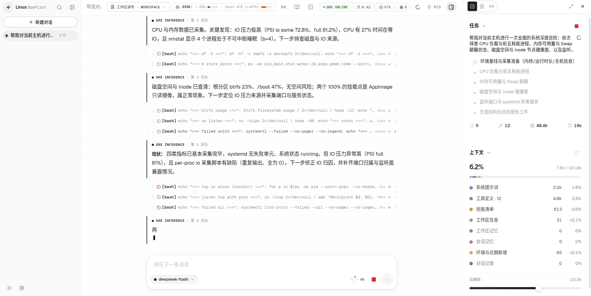
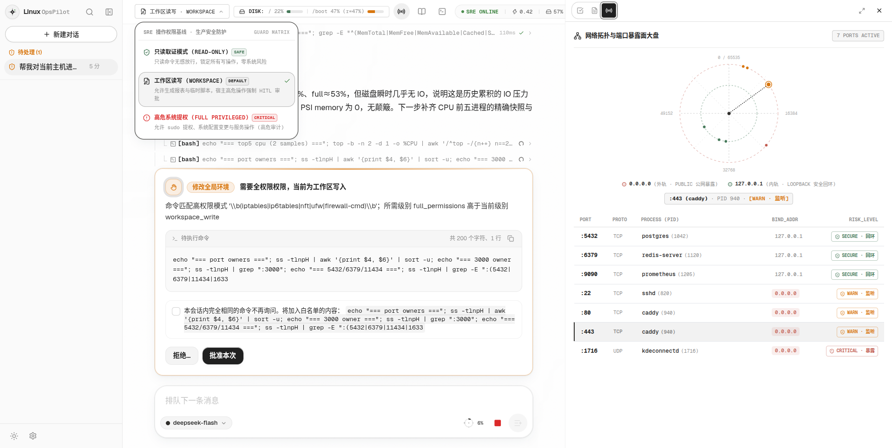
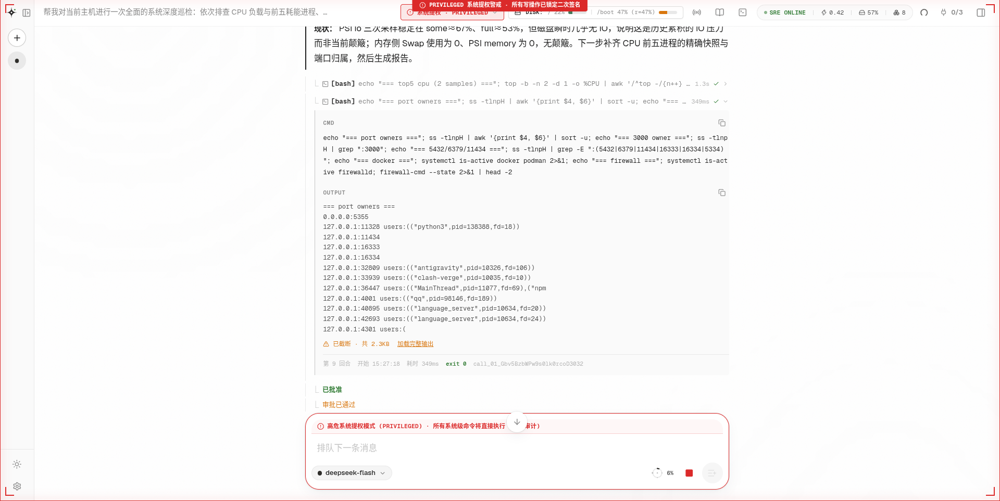
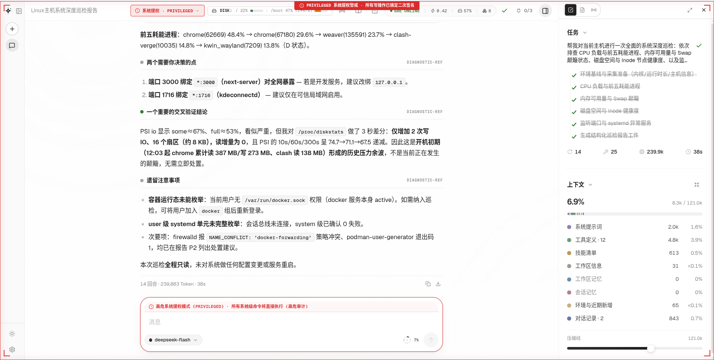
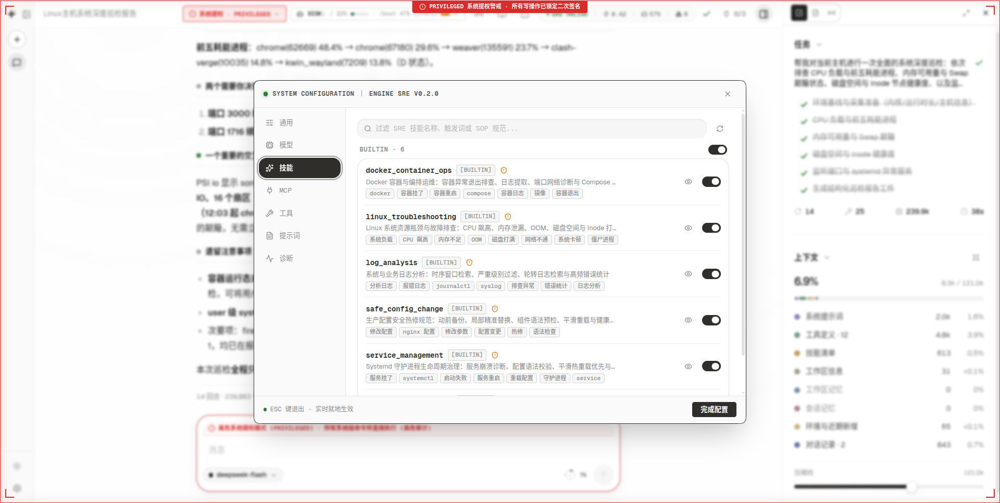
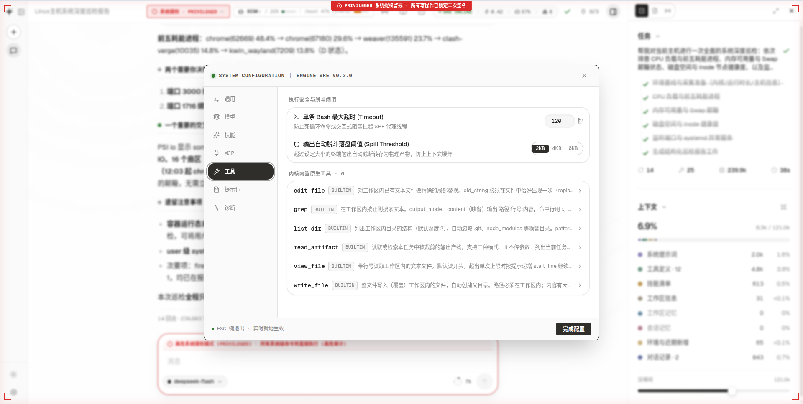

# LinuxOpsPilot

专为 Linux 生产与运维环境打造的智能 SRE 故障排查与运维治理智能体（Autonomous Linux SRE Agent）。
提供 CLI-First 原生优先的底层 Harness 运行时，与融合 `omoi-aesthetic` 极简几何线条艺术的 **SRE 智能作战指挥舱（Mission Control Cockpit）** 前端。

---

## 🖥️ 系统界面与交互展示 (Visual Cockpit Showcase)

LinuxOpsPilot 搭载自研的 `omoi-aesthetic` 工业三层景深体系，彻底告别千篇一律的通用对话框，呈现建筑图纸级别的专业 SRE 运维座舱：

### 1. 排障主工作台与任务计划编排 (Main SRE Cockpit & Subtask Planning)
> **多工具并行诊断、阶段性任务计划实时推进与上下文水线量化监控**



- **左侧会话引线**：极简无框垂直时间轴，支持随时切换多运维会话；
- **核心推理流**：展示 Agent 在执行工具调用前的“现状 / 下一步 / 依据”阶段小结，每个 `bash` 原生命令带状态回执与毫秒级耗时；
- **右侧任务编排面板**：基于 `update_plan` 拆解的子任务清单（Checklist），随排障深入实时更新打钩与推进进度；
- **动态上下文水线**：精确可视化系统提示词、工具定义、技能清单、环境记忆与对话记录的 Token 占比与压线阈值。

---

### 2. 权限防御矩阵、人机协同（HITL）审批与网络拓扑雷达 (Guard Matrix & HITL Approval)
> **三级权限阶梯、高危操作主动拦截与 240px 极坐标端口暴露面大盘**



- **操作权限基线（SrePermissionGuard）**：常驻顶部导航栏，支持「只读取证模式 (READ-ONLY)」、「工作区受控读写 (WORKSPACE)」与「高危系统提权 (PRIVILEGED)」无缝切换；
- **人机协同审批卡片（HitlApprovalCard）**：当 Agent 试图触碰高危命令（如防火墙、网关、进程终止）时，运行时自动挂起并弹出 1px 细线工程卡片，提供完整命令预览、参数白名单机制及“批准 / 拒绝”物理微按键；
- **极坐标暴露面雷达（SreNetworkStorageDial）**：240px 雷达图透视 0~65535 端口分布，区分外网公网暴露（红点）与本地回环安全回环（绿点），联动高亮展示进程 PID 与安全评级。

---

### 3. 高危系统提权审计与工具卡片深度取证详情 (Privileged Mode Audit & Tool Details)
> **顶栏朱红警戒线、输入审计红框与展开的工具调用详情**



- **全局提权警戒态**：进入高危提权模式后，视口顶部与输入框同步常驻 1px 朱红告警红线（CRITICAL），全量系统命令接受安全审计与二次确认；
- **展开式工具卡片（ToolCard）**：点击任意命令可展开完整 CMD 命令行、原生 OUTPUT 标准输出，支持长日志自动脱斗截断提示（加载完整输出）与单次调用执行元数据。

---

### 4. SRE 深度巡检交付总结与全阶段任务达成 (SRE Post-Mortem & Completed Pipeline)
> **6 大子任务全绿闭环、多维度交叉验证推导与遗留决策建议**



- **结构化诊断推导**：Agent 自主总结前五高耗能进程、提炼出需要人类工程师决策的网络暴露点，并基于 `/proc/diskstats` 给出历史与当前 IO 压力的交叉验证结论；
- **闭环任务达成**：右侧任务清单 6/6 全绿达成，记录 14 轮对话、25 次工具调用、239.9k Token 消耗与 38 秒总响应时间；
- **零系统漂移**：明确标明本次巡检全程只读，未对生产系统造成任何未授权变更或服务抖动。

---

### 5. Layer 2 原地几何配置图纸小视窗 (In-place Geometric Settings Modal)
> **快捷键 `Ctrl + ,` 原地唤出 860×600px 纯白图纸视窗，零页面跳转，原地修改、实时生效**

| 技能中心 (Built-in Skills Management) | 原生工具与安全脱斗阈值 (Tools & Spill Threshold) |
| :---: | :---: |
|  |  |
| **独立控制 5 大 SRE 核心 SOP 技能启闭**<br>纯物理高反差微拨动开关（Toggle），支持原地展开 SOP 规范代码抽屉 | **配置单条 Bash 超时时间与输出自动脱斗落盘阈值**<br>内置 6 大文件与诊断原生工具白名单，防止长日志撑爆模型上下文 |

---

## 为什么有 LinuxOpsPilot

现有的很多自主 Agent（如以写代码、拉分支、建代码仓库为核心的 Coding Agent）直接用于 Linux 生产运维时存在明显的错位：
- **单工作区死锁**：被死锁在特定的代码工程目录下，无法感知宿主机全局真实运行的系统配置（`/etc`）与日志（`/var/log`）；
- **缺乏 SRE 运维直觉**：遇到服务异常倾向于盲目猜测或直接重启，缺乏“先查监控、看日志、排网络、动前备份、语法前检、平滑重载、探针复核”的防事故防御本能；
- **权限与安全失衡**：要么为了能跑命令大开后门导致执行 `ip link down` 或 `iptables -F` 瞬间断网自毁，要么哪怕查个 `uptime`、`df -h` 都要频繁弹窗审批打扰运维人员；
- **过度包装与黑盒失控**：试图用笨重的 Python 代码包装单体诊断工具，缺少原始终端穿透，更无法在关键时刻由人类工程师平滑接管控制权。

LinuxOpsPilot 走纯粹的 **SRE 专精与 CLI-First 原生优先** 路线：
**将主循环控制权交给大模型，通过严密的权限矩阵、核心禁区防御、自动快照备份与标准化 SRE SOP，打造可靠、安全、知进退的 Linux 运维智能助理。**

---

## 核心设计支柱

### 1. CLI-First / Shell 原生优先
- 拒绝在后端搞抽象笨重的单体 Python 运维函数。
- Agent 通过 `bash` 原生并行编写非交互命令，自由调用 Linux 丰富的系统工具（`top`, `ss`, `ip`, `df`, `free`, `journalctl`, `systemctl`, `docker` 等），诊断输出自动流式截断并生成持久化句柄（`read_artifact`）。

### 2. SRE 黄金工作法五项纪律（系统提示词硬约束）
1. **先诊断后动刀（Observe First）**：严禁盲目重启。先并行调取资源负载（`top`/`free`/`df`）、连接状态（`ss -tulpn`）与服务错误日志（`journalctl -u <svc> -n 50 --no-pager`）。
2. **动前备份（Backup First）**：修改生产配置（如 `/etc/` 下文件）前必须保证快照留痕。`edit_file` 与 `write_file` 会自动备份至当前任务目录；bash 修改必须显式时间戳备份。
3. **语法前检（Pre-flight Syntax Check）**：重载服务前必须强制执行配置自检（`nginx -t`, `sshd -t`, `systemd-analyze verify`, `visudo -c`, `docker compose config`）。语法未通过绝不允许重载服务。
4. **平滑重载优先（Reload over Restart）**：支持热重载的组件优先执行 `systemctl reload` 或 `kill -HUP`，最大限度保障既有长连接业务无损。
5. **变更后健康复核（Health Probe）**：操作完成后主动检查进程 PID、服务状态与端口监听，确认无 Crash 后方可交付。

### 3. 去工作区架构（Zero-Workspace）
- 摒弃传统开发类 Agent 繁重的手动多工作区切换模式。
- 每个会话自动锚定在 `storage/workspaces/<session_id>` 专属轻量沙盒，存放该会话产生的临时排障脚本、分析报表与备份快照。

### 4. SRE 权限控制矩阵与防断网自毁审计
- **只读取证模式（`read_only`）**：`uptime`、`top`、`free`、`df`、`ss`、`ip`、`systemctl status`、`docker ps`、`journalctl` 等免审批直接执行。
- **工作区受控读写（`workspace_write`）**：允许在会话沙箱工作区内生成报表与排障脚本，宿主系统变更受控审批。
- **高危系统提权（`privileged`）**：`sudo` 提权命令、服务强行停启必须经由人类操作员（HITL）审批。
- **防自毁硬护栏（`NETWORK_SUICIDE_RISK`）**：在前置命令审计层坚决拦截 `ip link set ... down`、`ifconfig ... down`、`iptables -F`、`nft flush ruleset` 等导致主机失联的高危自毁指令。

### 5. 工具路径解绑与核心敏感禁区保护
- 文件工具（`view_file`, `edit_file`, `write_file`, `grep`）全面支持查看与局部热修宿主机绝对路径（`/etc/`, `/var/log/`, `/tmp/` 等）。
- 物理拦截核心系统禁区：无论是否经过审批，坚决拒绝触碰 `/boot`、`/sys`、`/proc`、`/dev` 硬件内核区与 `/etc/shadow`、`/etc/sudoers` 凭据区。
- 内建 YAML 语法进程内即时诊断，改动 Docker Compose 或 Kubernetes manifests 错误直接在观察值中反馈。

### 6. SRE 纯净技能库（Built-in SOPs）
内置 5 大生产级标准运维 SOP 技能 + Shell 最佳实践（支持运行时热装配与独立启闭）：
1. **`linux_troubleshooting`**：CPU 飙高、内存泄漏、OOM、磁盘容量/Inode 打满、网络拥塞定位排障 SOP。
2. **`service_management`**：Systemd 守护进程生命周期治理、崩溃原因分析、平滑重载与存活复核 SOP。
3. **`docker_container_ops`**：Docker 容器退出码诊断、崩溃日志提取、端口网络调试与 Compose 治理 SOP。
4. **`safe_config_change`**：生产配置动前备份、局部精准替换（Unified Diff）、语法预检自检与回滚预案 SOP。
5. **`log_analysis`**：journalctl/syslog 时序切片、严重级别过滤、轮转压缩归档检索（zgrep）与高频错误统计 SOP。
6. **`shell_best_practices`**：非交互模式规范、输出截断控制、避免高危操作的 Shell 执行守则。

---

## 🎨 前端：SRE 智能作战指挥舱 (Mission Control Cockpit)

前端采用 **`omoi-aesthetic`** 艺术哲学与工程生成体系（几何作图、建筑图纸感、1px 纯矢量轮廓、高反差纯白深墨、物理阻尼动态），彻底摒弃通用 AI 套壳的模板感：

- **五幕式建筑图纸开机自检（SreBootSplash）**：每次页面加载呈现十字准星定点、四向遥测引线微印、1px 墨线激光扫描与图纸展开仪式感。
- **全局 SRE 权限矩阵（SrePermissionGuard）与生产防事故红线（Production Guard）**：
  顶栏核心常驻只读（READ-ONLY）、工作区（WORKSPACE）与系统提权（PRIVILEGED）模式切换；切入提权模式常驻视口顶部 1px 朱红警戒线。
- **Live PTY 终端穿透与人类接管控制台（SreTerminalDrawer）**：
  底部可自由拉伸高度的终端视窗，右上角展示 1px 细线实时 `BUS_LOAD` 正弦心跳波纹；提供「智能体自治」与「人类协同接管」双向平滑切换。
- **交付产物阅读抽屉与 Playbook 固化（SreArtifactDrawer）**：
  排障报表（如《巡检调优诊断大盘.md》）支持原地向左滑出 480px 纯白图纸抽屉，集成 1px 垂直刻度 TOC 目录导航，并提供一键导出 PDF 与提取自愈 Playbook 脚本。
- **极坐标端口暴露面雷达与存储压力槽条（SreNetworkStorageDial）**：
  240px 极坐标雷达直观透视内网回环与公网暴露面，配合 1px 线框端口明细表双向高亮联动；顶栏集成存储压力槽微气泡穿透。
- **原地几何配置小视窗（SreSettingsModal）**：
  彻底废除全屏页面跳转，按 `Ctrl + ,` 或点击齿轮在原地呼出 860x600 纯白图纸视窗；全站采用黑白高反差纯物理微开关（SRE Geometric Toggle），独立控制 5 大 SRE 技能、MCP 生态与工具白名单。
- **执行流去框化与双通道隔离**：
  底层机器工具流收敛为极简无框垂直时间引线（Timeline Rail），Agent 阶段决策小结（现状... 下一步...）升级为独立高反差编辑体（2px 墨线引导）。
- **纯 SVG + GeometricTooltip 极简交互**：
  全站所有按钮与控制器收敛为固定尺寸纯矢量 SVG 容器，零中文字符伸缩抖动，辅助说明全量外挂 Layer 3 几何工程微气泡。

---

## 快速开始

### 1. 环境准备
- **操作系统**：Linux（生产首选）或 macOS。
- **Python 环境**：Python 3.12（推荐使用 [`uv`](https://github.com/astral-sh/uv) 自动管理）。
- **Node 环境**：Node.js >= 20，`pnpm >= 9`。

### 2. 配置密钥与环境
复制环境变量模板并填入模型密钥：
```bash
cp .env.example .env     # 填写 DEEPSEEK_API_KEY（或其它 OpenAI 兼容提供商密钥）
```

### 3. 一键安装依赖与自检
```bash
make install             # 一键同步 Python 虚拟环境与安装前端依赖
make check               # 运行静态分析 + 类型检查 + 离线回归测试（2000+ 后端单测 + 137 前端单测）
```

### 4. 启动服务
```bash
make start               # 一键并发启动全套服务
# 或进入后端目录执行专属 CLI：
cd backend && uv run linuxops start
```

**启动增强特性**：
- **SPA 单端口全托管（生产推荐）**：当检测到已构建的 `frontend/dist` 且未指定 `--dev` 时，后端直接单一端口托管静态前端（默认 `http://127.0.0.1:11328`），无需 Node.js 进程，节省 ~150MB+ 内存；
- **前端热重载开发模式**：加上 `--dev` 参数同时拉起 Vite 开发服务器（访问 `http://127.0.0.1:5173`）；
- **端口冲突自动顺延（Port Auto-hunting）**：自动探测并顺延被占用的端口（11326/11327/11328），并动态注入子进程环境变量；
- **SRE 启动前磁盘预检**：启动前自动检查运行时主目录剩余磁盘空间（低于 200MB 给出高亮警示）。

服务端口矩阵（默认）：
- **后端核心 API & SPA 仪表盘**：`http://127.0.0.1:11328`
- **前端 Vite 开发服务器**（`--dev` 模式）：`http://127.0.0.1:5173`
- **Shell 沙箱 Sidecar**：`http://127.0.0.1:11326`
- **Web 搜索 Sidecar**：`http://127.0.0.1:11327`

---

## 部署与生产运维加固

### 1. 本地回环与网络暴露原则
- LinuxOpsPilot 默认严格绑定在 `127.0.0.1` 本地回环接口。
- **切勿将控制台端口裸露暴露在公网**。推荐通过 **Tailscale / WireGuard** 私有虚拟网或 **SSH 端口转发隧道** 进行远程安全访问：
  ```bash
  # 本地终端建立加密隧道直连远程服务器：
  ssh -N -L 11328:127.0.0.1:11328 user@your-server-ip
  ```

### 2. Linux Systemd 常驻服务配置
创建 `/etc/systemd/system/linuxopspilot.service`：
```ini
[Unit]
Description=LinuxOpsPilot SRE Runtime Service
After=network.target

[Service]
Type=simple
User=your_username
WorkingDirectory=/path/to/LinuxOpsPilot/backend
EnvironmentFile=/path/to/LinuxOpsPilot/.env
ExecStart=/usr/local/bin/uv run linuxops start --no-frontend
Restart=always
RestartSec=3

[Install]
WantedBy=multi-user.target
```
启停命令：
```bash
sudo systemctl daemon-reload
sudo systemctl enable --now linuxopspilot
sudo systemctl status linuxopspilot
```

### 3. 前端静态打包与 Nginx 反向代理
生产环境推荐静态打包并通过 Nginx 托管：
```bash
cd frontend && pnpm build   # 静态资源输出至 frontend/dist
```

Nginx 反向代理配置（支持 SSE 禁用缓冲）：
```nginx
server {
    listen 80;
    server_name linuxops.internal;

    location / {
        root /path/to/LinuxOpsPilot/frontend/dist;
        try_files $uri $uri/ /index.html;
    }

    location /api/ {
        proxy_pass http://127.0.0.1:11328;
        proxy_http_version 1.1;

        # 关键：支持 SSE 事件流实时推流
        proxy_set_header Connection '';
        proxy_buffering off;
        proxy_cache off;
        chunked_transfer_encoding on;

        proxy_set_header Host $host;
        proxy_set_header X-Real-IP $remote_addr;
    }
}
```

---

## 仓库结构

```
LinuxOpsPilot/
├── backend/                 # Python 3.12 SRE 运行时、API、沙箱 Sidecar 与评测体系
│   ├── src/agent_runtime/   # 主循环、权限策略、提示词工程、检查点与存储
│   ├── src/services/        # 独立的 bash_shell 与 web_search 安全沙箱
│   ├── src/skills/          # 5 大内置生产级 SRE SOP 技能包
│   ├── src/tools/           # 内置文件/检索/Shell/YAML即时诊断工具
│   └── tests/               # 2038 个单测与端到端真实 SRE 生产集成测试套件
├── frontend/                # React 19 + Tailwind CSS SRE 智能作战指挥舱
│   ├── src/components/      # 终端抽屉、产物抽屉、雷达大盘、防护红线、几何微控件
│   ├── src/features/        # 决策小结流、快捷运维卡片、去框化引线、检视器
│   ├── src/stores/          # 指挥舱状态机 (useCockpitStore)、权限基线与交互状态
│   └── dist/                # 生产静态单端口打包产物
├── config/config.toml       # 运行时权限、核心禁区、端点降级与参数策略
├── docs/                    # 完整设计文档与《前端审美Skill规范》
└── Makefile                 # 一键开发、测试与构建入口
```

---

## 质量与测试保证

代码库包含严格的契约保障与全量自动化回归测试：

- **后端测试**（2038+ 项测试用例全部通过）：
  ```bash
  cd backend && uv run pytest
  # 2038 passed in 61.62s (100% 通过率，0 失败)
  ```
  - `tests/test_ops_scenarios_e2e.py`：端到端真实 SRE 生产运维链路验证；
  - `tests/test_permissions.py`：SRE 运维命令权限分类覆盖；
  - `tests/test_tools_files.py` / `test_tools_edit_search.py`：路径沙箱与核心禁区安全防御验证；
  - `tests/test_builtin_skills.py`：SRE 技能包元数据与防注入合规校验。

- **前端测试**（25 套测试套件，137+ 项测试全部通过）：
  ```bash
  cd frontend && pnpm test
  # 25 passed (25 test files), 137 passed (137 tests)
  ```
  - `SreBootSplash.test.tsx` / `SreArtifactDrawer.test.tsx` / `SreTerminalDrawer.test.tsx`：指挥舱核心组件深度测试；
  - `SreNetworkStorageDial.test.tsx` / `SreProductionGuard.test.tsx`：网络暴露面与权限红线防护测试；
  - `RunView.test.tsx` / `ToolCard.test.tsx` / `SayBlock.test.tsx`：去框化引线流与决策小结测试。
